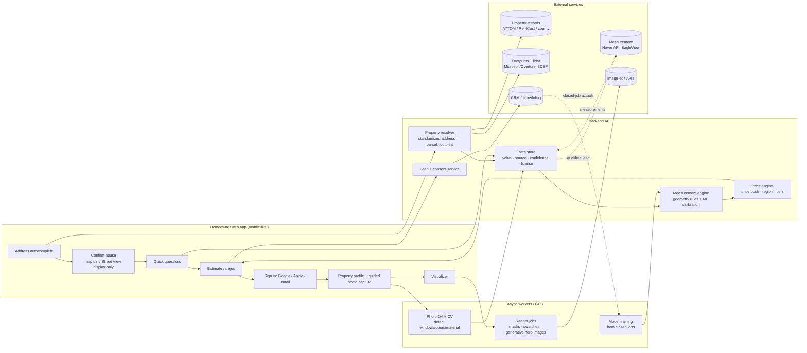

# 4. Architecture and phased roadmap

## Design principles

1. **Range, not a number.** Every quantity and price is a P10/P50/P90 range with stated assumptions.
2. **Every fact has a source and a license.** Store `source`, `as_of`, `confidence`,
   `license_tag` on each property attribute. Homeowner-provided facts override public ones. This
   is how you honor caching rules (e.g., don't persist Google content) and explain estimates.
3. **Quantities ≠ prices.** The measurement engine outputs squares, linear feet and units. The
   price engine applies your price book. You'll change prices far more often than geometry logic.
4. **Swappable data providers.** One `PropertyDataProvider` interface with ATTOM, RentCast,
   Regrid and county adapters behind it. Vendors change prices and terms.
5. **Closed jobs feed back in.** Final measured quantities from installed jobs are the training
   data. Build that loop from the first version.
6. **No sign-in wall for the first estimate.** Ask for an account to *save*, *tighten*, or *visualize*.

## Reference architecture

### Suggested stack (defaults, not requirements)

| Layer | Default | Why / alternatives |
|---|---|---|
| Web app | Next.js (TypeScript), mobile-first. Native app later if needed | Most homeowners arrive from ads and search on phones. A web app avoids App Store review at first. |
| Auth | A managed provider (Supabase Auth, Firebase Auth, Auth0, Clerk) with Google, Apple and email magic link | If you ship an iOS app with Google sign-in, App Store guideline 4.8 requires an equivalent privacy-preserving option, and Sign in with Apple qualifies ([Apple forum on 4.8](https://developer.apple.com/forums/thread/765145)). Offer email too, because many homeowners won't use social login. |
| API + workers | Python (FastAPI) + a job queue | Python is the natural home for geometry, ML and CV code |
| Database | Postgres + PostGIS | Footprints, parcels and spatial joins. A JSONB facts table with provenance columns |
| Files | S3-compatible object storage (S3, R2, GCS) | Homeowner photos and renders. Private by default, signed URLs |
| Address | Smarty (USPS-standardized) or Google Places (store only `place_id`) | See [01-data-sources.md §D](01-data-sources.md#d-address-entry-small-but-it-matters) |
| CRM | Whatever your sales team already uses (HubSpot, JobNimbus, Salesforce, etc.) | Push leads in. Pull back closed-job actuals for training |
| Analytics | Product analytics + an estimate-accuracy dashboard | Track estimate-vs-final error and conversion |

### Core data model (sketch)

- `property`: standardized address, parcel ID, footprint geometry, lidar height
- `property_fact`: property_id, attribute, value, unit, **source**, **as_of**, **confidence**, **license_tag**, provided_by (system/homeowner/rep)
- `homeowner`: auth identity, contact, **consent records** (what, when, exact wording shown)
- `photo`: property_id, elevation (front/back/left/right/detail), uploaded_by, detections JSON, review status
- `estimate`: property_id, version, input-facts hash, model version, line items with P10/P50/P90, assumptions shown to the user
- `price_book`: products, tiers, regional labor, adders (tear-off, RRP, permits), effective dates. Add `tenant_id` now if this might ever serve other dealers.
- `job_actual`: closed jobs with measured squares, window list (size/type), doors, final price. This is your training data.

### Variable cost per estimate (rough)

| Item | When | Rough unit cost |
|---|---|---|
| Property record lookup | Every address | About $0.015–$0.20 per request on RentCast's reported tiers. ATTOM/Cotality by contract |
| Footprint + lidar | Every address | Free (open data). You pay only compute/storage |
| Street View display | Every address (optional) | About $0.007 each after the free threshold |
| LLM vision on photos | Signed-in users who upload | Typically cents per photo. Check current model pricing |
| EagleView / Hover | Qualified or booked leads only | ~$18–$67.50+ per EagleView report; ~$29–$139 per Hover project (reported) |
| Generative renders | Visualization users | ~$0.01–$0.24 per image |

Most cost will be engineering time, not data.

---

## Phased roadmap

### Phase 0: Prove the estimate on your own jobs (2–4 weeks)

**Goal:** know your real error before building UX.

1. Export **100–300 completed jobs** with address, measured siding squares, window list
   (count/type/size), doors, product tier and final price. Use [`data/backtest-template.csv`](../data/backtest-template.csv).
2. For each address, pull assessor data (your county, free), one paid provider trial (ATTOM trial
   or RentCast free/low tier), the footprint (Microsoft/Overture), and 3DEP height.
3. Run the geometry rules and fit a simple quantile model.
4. Measure error (median absolute % error and P90 error) for siding squares, window count and total price.

**Exit criteria (decide with sales):** an address-only range narrow enough that homeowners and reps
find it credible. Write the threshold down before you look at the results. If address-only is too wide,
make the "quick questions" step mandatory in Phase 1. That is probably the right design anyway.

### Phase 1: MVP instant estimate (6–10 weeks)

- Address → confirm the house (map pin; Street View for display only) → pre-filled facts the
  homeowner confirms ("2 stories, ~1,900 sq ft. Right?") → 5–8 quick questions.
- Output: siding / windows / doors **ranges** by good/better/best tier, the assumptions behind them, and
  "what would tighten this."
- Book a consultation; lead goes to CRM with full context; consent logged.
- Internal admin: price book editor; estimate review; accuracy dashboard.
- **No accounts yet.** Optional email to save the estimate.

**Success metrics:** completion rate (address → estimate), estimate → appointment rate, and later
estimate-vs-final price error.

### Phase 2: Accounts and progressive property profile (6–8 weeks)

- Sign in with Google, Apple or email. Saved property profile with provenance shown to the user.
- **Guided photo capture**: front/back/left/right with on-screen framing tips and quality checks.
- CV assist: LLM vision or a detector proposes window and door counts and siding material. The homeowner or rep confirms.
- **"Estimate confidence" meter** ("±25% → add back photos to get to ±15%"). This is the
  "more info, better estimate" reward from your concept, made concrete.
- Hover capture link for serious leads; automatic EagleView order when an appointment is booked.
- Start the **closed-job feedback loop** (CRM → `job_actual` → monthly recalibration).

### Phase 3: Visualization (start after Phase 2 data exists)

- **3a:** embed or link a partner visualizer (Hover or your main manufacturer) and measure usage and lift.
- **3b:** own pipeline on uploaded photos: segmentation masks → real-time swatch swaps;
  pre-rendered generative hero images with automated checks (see [03-visualization.md](03-visualization.md)).
- Tie visuals to catalog SKUs. "Save this design" flows into the proposal.

### Phase 4: Learn and scale

- Retrain on closed jobs; A/B test how ranges are presented; financing pre-qualification;
  e-signature proposals.
- Multi-region price books. Multi-tenant if you decide to offer this to other dealers.
- Revisit self-hosted real-time generative only if the data shows visualization drives sales.

### Team (rough)

Phase 0–1: one strong full-stack engineer, plus someone from sales or estimating who owns the
price book and labels past jobs. Phase 2–3: add a part-time ML/CV engineer. Budget a few hours
of counsel for data licenses, privacy policy, TCPA consent language and visualization
disclaimers before launch.
