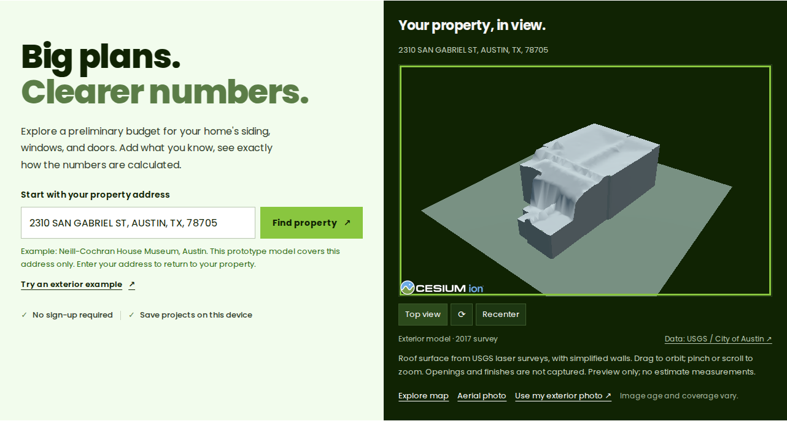

# Exterior prototype from public lidar

## Result

Select **Try an exterior example** on the Address step. The Neill-Cochran House
Museum in Austin opens as a small 3D model. No account or map key is required.
Drag to orbit. Scroll or pinch to zoom. Use the Top view, rotate and Recenter
buttons. When the canvas has focus, arrow keys rotate, plus/minus zoom, and Home
resets the view.



[Phone screenshot](assets/exterior-phone.png) · [Top view screenshot](assets/exterior-top.png)

This is one reviewed property. It is not a national address-to-model service.
Other addresses keep the existing Google 3D or aerial flow. An address edit clears
the example immediately. A model failure returns to aerial imagery.

## What the model represents

| Part | Source and treatment |
|---|---|
| House identity | [Public museum address](https://www.nchmuseum.org/contact/), checked against its location and aerial imagery |
| Footprint | City of Austin, Building Footprints 2023, feature 593853 |
| Roof | USGS Central Texas B1 2017 lidar, classified building returns |
| Walls | Inferred vertical surfaces from the footprint boundary to nearby roof returns |
| Ground pad | Flat presentation surface. It is not a parcel boundary or terrain survey |
| Colors | Neutral display materials. They are not sampled finishes |

The preprocessing run reads 16 EPT nodes, crops 52,505 points, and uses 1,907
building returns inside the footprint. The roof retains 1,024 upper-surface
samples on a 0.6 m grid. Triangles may interpolate gaps up to 3 m; the largest
boundary interpolation is approximately 2.59 m. The 99.62% roof coverage value
is **triangulated footprint coverage**, not a measurement-accuracy score.

The 2017 survey and 2023 footprint may differ from the current house. Trees,
classification errors and sparse eaves can affect the roof. Walls, openings,
finishes and dimensions have not been verified. Nothing in this model changes
the estimate inputs or supplies quotation measurements.

## Files

- `data/exterior/neill-cochran.json`: reviewed identity, footprint and source configuration.
- `tools/build_exterior.py`: offline EPT crop, ground normalization and mesh export.
- `assets/exteriors/neill-cochran/model.glb`: 76,164-byte display model, including lighting normals.
- `assets/exteriors/neill-cochran/prior.glb`: building-only mesh, without the presentation pad.
- `assets/exteriors/neill-cochran/manifest.json`: source nodes, processing counts, units,
  limitations and model SHA-256.
- `exterior-catalog.js`: exact address and nearby coordinate check. Proximity alone is insufficient.
- `property-exterior.js`: local GLB renderer, cancellation and orbit controls.
- `cesium-runtime.js`: shared, lazy Cesium runtime. No new browser dependency.

The export uses local metres in a house-centered projection. It does not treat
Web Mercator distances as ground metres. The viewer displays the model in a local
frame and does not treat source orthometric elevation as ellipsoid altitude.

## Rebuild the model

Use Python 3.11 or newer in a virtual environment. The scientific packages are
only needed for preprocessing; Node deployments serve the committed assets.

```bash
python -m venv /tmp/curbquote-exterior-env
/tmp/curbquote-exterior-env/bin/pip install -r tools/exterior-requirements.txt
/tmp/curbquote-exterior-env/bin/python tools/build_exterior.py \
  --config data/exterior/neill-cochran.json \
  --output assets/exteriors/neill-cochran \
  --cache /tmp/curbquote-ept-cache
```

The tool supports USGS LASzip EPT collections in EPSG:3857 with a JSON hierarchy.
It uses classified ground (2) and buildings (6), removes withheld returns, and
rejects missing coverage, insufficient observations and large roof gaps. Some
surveys do not classify buildings. Those surveys need another validated process.
Downloads have node and response-size limits. Do not commit the raw tile cache.

For another property, review its building identity and footprint first. Select
an EPT collection that covers it. Create a source config, generate and inspect
the output, then add reviewed coverage to the catalog and public asset list.
The current catalog intentionally exposes only the museum example.

## SAT-Skylines next step

[SAT-Skylines](https://github.com/JinZhangYu/SatSkylines) is relevant because it
conditions exterior generation on overhead imagery and coarse building geometry.
Its [paper](https://arxiv.org/abs/2508.18531) trains with stylized building assets.
The measured shell could supply a geometric prior after the model's required
coordinate normalization and voxel conversion. This is a proposed integration,
not a claim that this GLB is already an accepted SAT-Skylines input.

Checked on 2026-10-21: the dataset is released; the official model weights,
inference code and training script remain unchecked in the release checklist.
The [USC Research license](https://github.com/JinZhangYu/SatSkylines/blob/main/LICENSE.rst)
permits educational, research and nonprofit use and directs commercial users
to obtain permission. No SAT-Skylines code, dataset, weights or assets are bundled.

When an authorized inference release is available:

1. Pair the reviewed geometry with suitably licensed, aligned overhead imagery.
2. Normalize and voxelize the building-only mesh for the released input contract.
3. Run generation in a GPU worker and store the generated model with provenance.
4. Label its inferred facade details as generated. Keep the measured and generated
   models distinguishable, and keep both out of the estimate calculation.

The original `kaiyungtan/3D_houses` project informed the workflow discussion.
This exporter is an independent implementation; no code from that repository
was copied.

## Verification

```bash
npm run check
npm run test:browser
npm run test:exterior
```

The exterior browser check uses the **real committed GLB and real Cesium runtime**.
It checks lazy loading, absence of paid 3D requests, camera controls, responsive
layout, unchanged estimate inputs, address edits during a delayed load, failure
fallback and retry. Only the unrelated address/imagery fallback is mocked.

## Data references

- [USGS public EPT collection](https://usgs-lidar-public.s3.amazonaws.com/USGS_LPC_TX_Central_B1_2017_LAS_2019/ept.json)
- [USGS point-cloud data and public-domain status](https://data.usgs.gov/datacatalog/data/USGS:b7e353d2-325f-4fc6-8d95-01254705638a)
- [City of Austin Building Footprints 2023](https://maps.austintexas.gov/arcgis/rest/services/Shared/PlanimetricsSurvey_1/MapServer/0)
- [Entwine Point Tile format](https://entwine.io/en/latest/entwine-point-tile.html)
