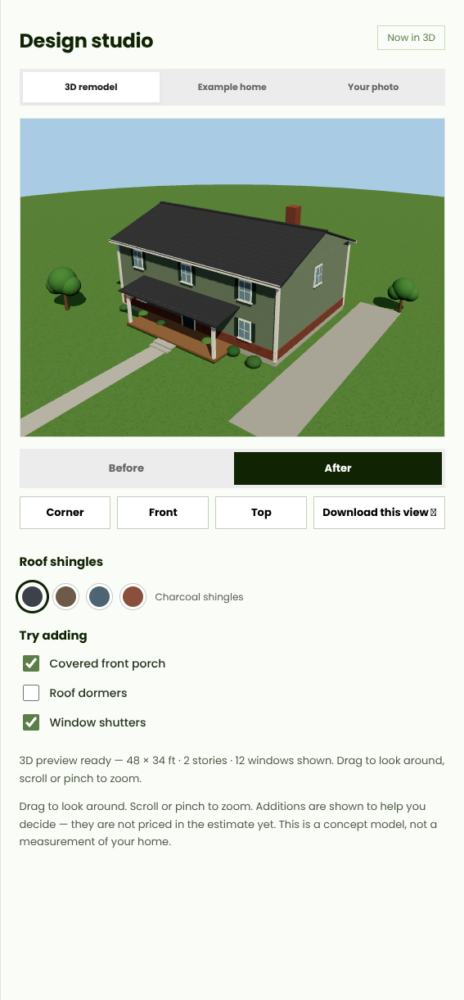
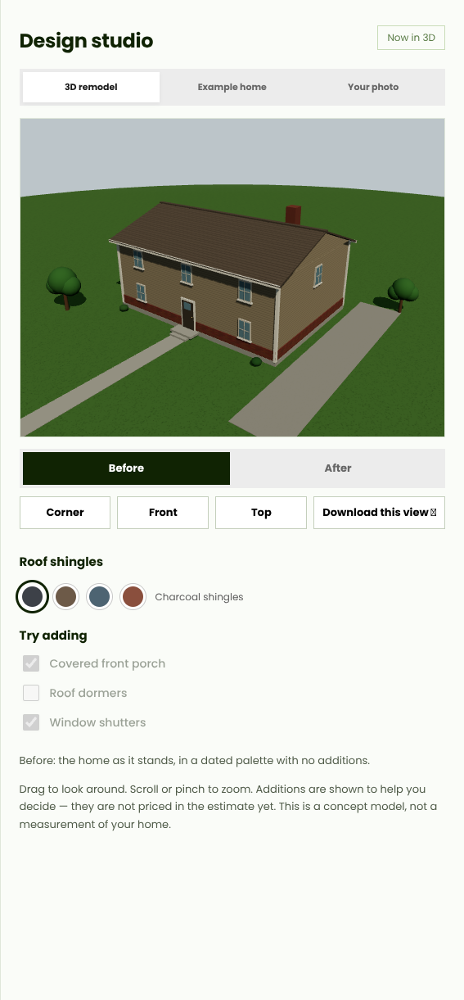
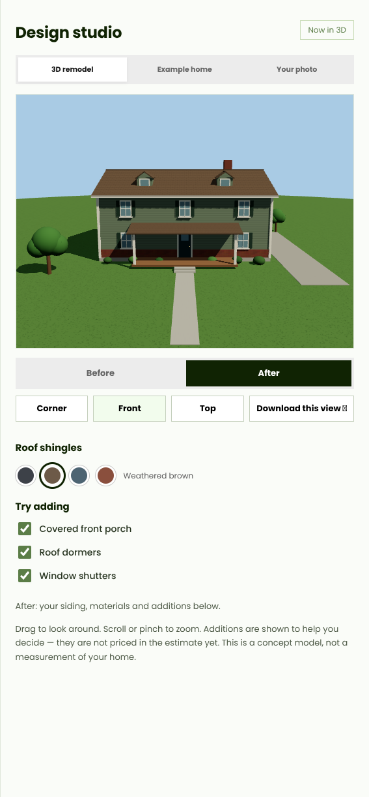
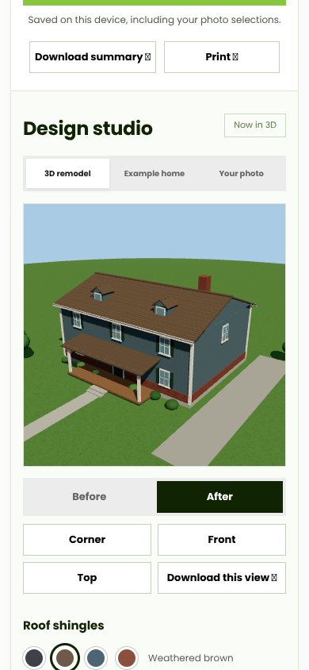

# 3D remodel studio — v0.9

The product goal is a good-looking 3D view of the property that a homeowner can restyle — new
siding, roofing, windows, doors and additions — and compare before and after. Two different
things supply that, and this release builds the second one:

| Job | What supplies it |
|---|---|
| See the **real** property today | Google Photorealistic 3D Tiles after an address match ([docs/13](13-google-3d-view.md)). Already built; needs `GOOGLE_MAP_TILES_KEY` (or a testing Cesium ion token) in the deployment to light up. |
| See the **proposed** renovation | This studio. Google's tiles can't be edited or traced (their policies forbid it), so the "after" house is our own model, built in the browser. |

## What the homeowner gets

On the estimate step, the Design studio now leads with **3D remodel**:

- A shaded, orbitable house with lawn, walk, driveway and trees. Drag to look around, scroll or
  pinch to zoom; **Corner**, **Front** and **Top** jump the camera; arrow keys, +/− and Home
  work when the canvas has focus.
- **Before / After.** Before is the same house in a dated palette, with no additions and duller
  light. After applies everything chosen on the page.
- The house follows the estimate inputs live: length, width, stories, story height, gable rise
  and the real total window count size and populate it; a brick/stone share of 10% or more shows
  as a masonry skirt. Siding product, siding colour, window and door products from step 4 drive
  its materials (lap, wide lap or board-and-batten textures are drawn on a canvas, tinted by the
  chosen colour).
- **Try adding**: a covered front porch, roof dormers and window shutters, plus four roof-shingle
  colours. Additions are clearly labelled as *not priced yet* — the estimate maths is untouched.
- **Download this view** saves the current angle as a PNG.

## How it is built

- `house-spec.js` is pure: it clamps or falls back on anything still being typed, spreads the
  window count across faces and floors (keeping the front ground floor clear of the door), and
  returns feet-based dimensions plus colours. It is unit-tested in `tests/remodel.test.js`.
- `remodel-3d.js` renders that spec with self-hosted Three.js (MIT), vendored like MapLibre as
  `vendor/three/{three.module.js, three.core.js, LICENSE.txt}` — about 2 MB, lazy-loaded the
  first time the panel is actually on screen (an `IntersectionObserver` opens and pauses it), so
  the earlier steps never pay for it. Rendering pauses when the panel scrolls away, and if WebGL
  fails the panel says so and the other two studio tabs keep working.
- Display only, like every other preview here: nothing is measured from the render, sent anywhere,
  or fed to the estimator or assistant. No new network origins, so the CSP is unchanged.

## Honest limits, and what comes next

- This is a *concept* house sized from typed measurements, not the property's real shape. The
  drafts toward a real footprint already exist: the LiDAR exterior example in draft PR #3, and
  Google 3D for the true "before". A future step can size/shape this same editable model from a
  reviewed footprint + LiDAR heights (independently sourced, never traced from Google's tiles),
  so the After house matches the real outline.
- Porch/dormer/shutter choices and roof colour live in the studio only: they are not saved with
  projects and not priced. Pricing them belongs with the Phase 0 back-test, not invented rates.
- SAT-Skylines and similar satellite-to-facade models remain research: no released weights or
  inference code were available, so nothing from them is bundled or claimed.

## Verification

- `npm run check`: 72 Node tests (5 new for the spec and Three.js packaging) and the public build.
- `npm run test:browser`: 36 app checks, 10 map checks, and 4 new 3D remodel checks
  (`qa/remodel-browser.mjs`) covering lazy loading, a non-blank shaded frame, Before/After and
  porch repaints, camera views, PNG download, and restyle/resize following steps 3–4.
- Screenshots above were taken from the running app (default 48 × 34 ft, 2-story example values).
