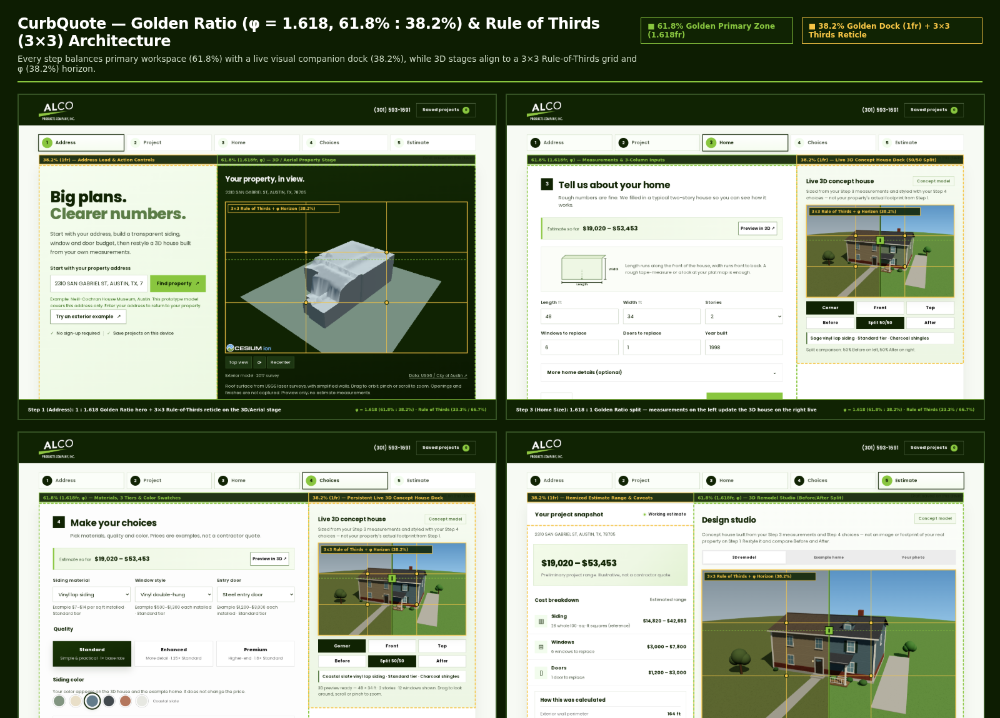
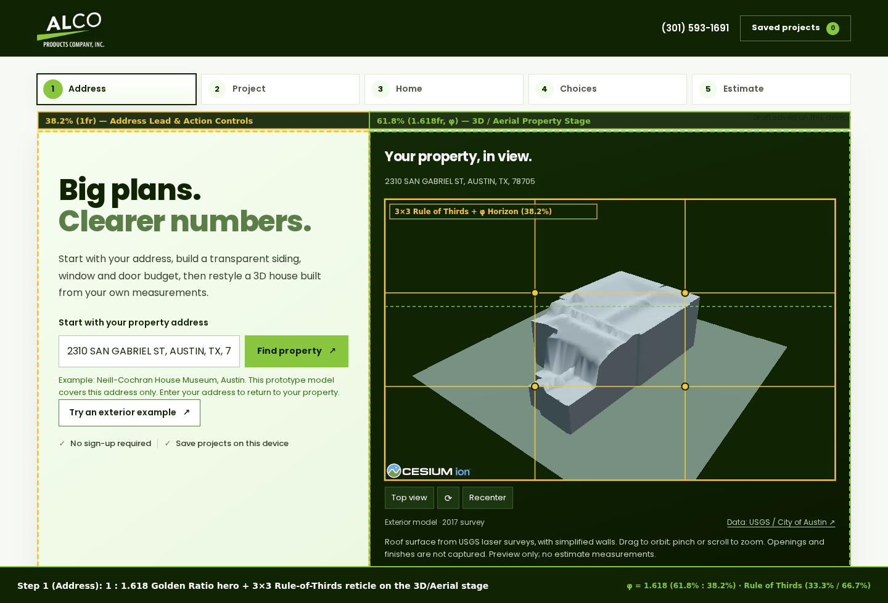
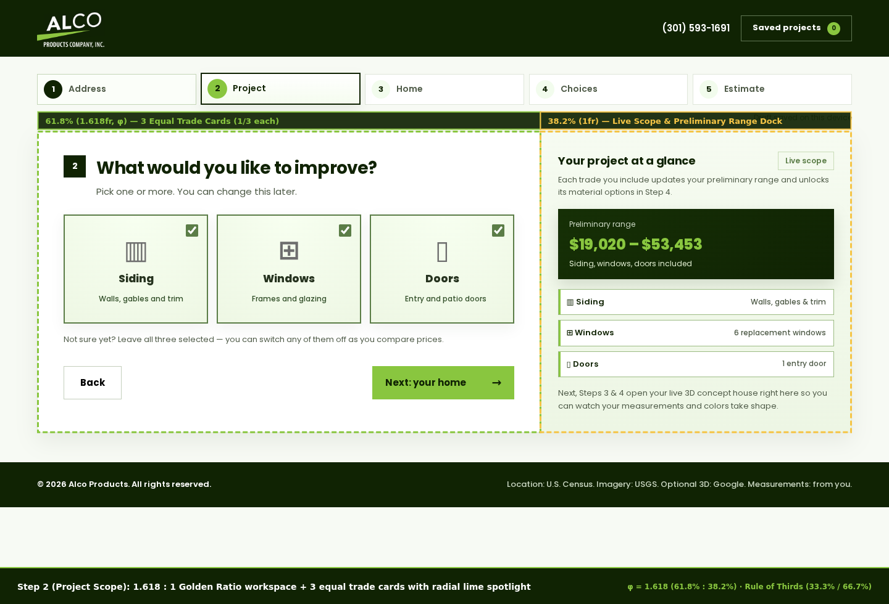
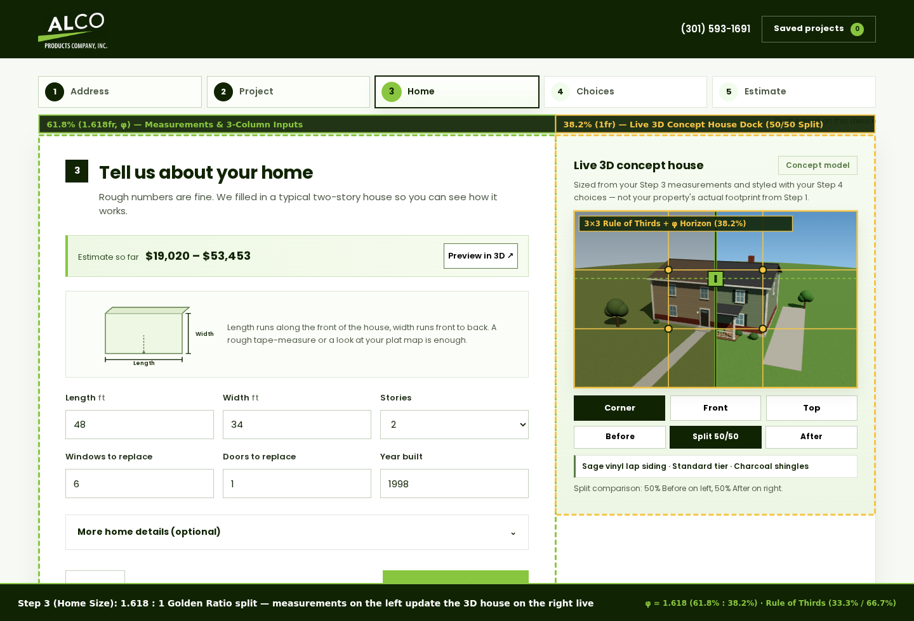
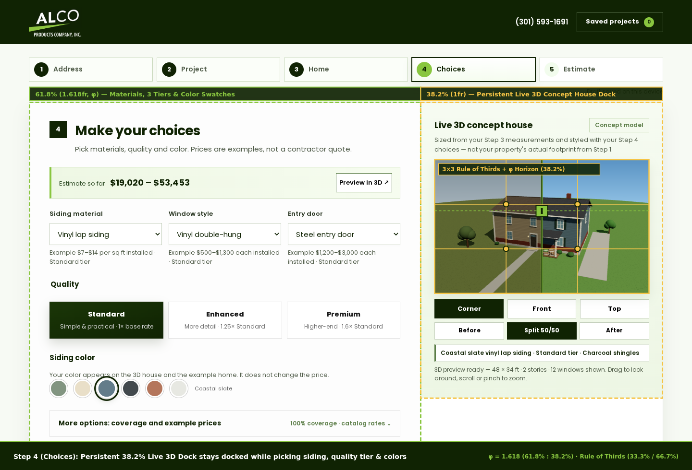
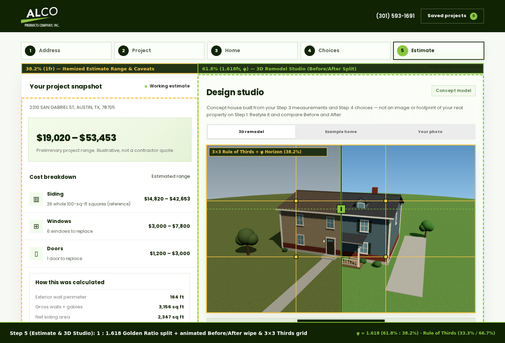

# 18 — Golden Ratio (φ = 1.618), Rule of Thirds & Live 3D Split UX Pass

This document records the layout, composition, animation, and scannability pass on **CurbQuote by Alco Products Company, Inc.**

---

## 1. Golden Ratio ($\varphi = 1.618$, $61.8\% : 38.2\%$) & Rule of Thirds ($3\times 3$) Layout Architecture

Every step of the 5-step homeowner journey now uses a consistent **Golden Ratio ($1.618\text{fr} : 1\text{fr}$, $61.8\% : 38.2\%$)** two-column desktop proportion paired with **Rule of Thirds ($3\times 3$ and $1/3 : 1/3 : 1/3$)** internal rhythm:

| Step | Primary Zone ($61.8\%$, $1.618\text{fr}$) | Companion Zone ($38.2\%$, $1\text{fr}$) | Rule of Thirds ($3\times 3$ / $1/3$ Rhythm) |
|---|---|---|---|
| **Step 1 — Address** | **3D / Aerial Property Stage** (`1.618fr`) — real property view leads visually | **Address Lead & Entry** (`1fr`) — headline, street input, Austin lidar example | Subtle $3\times 3$ composition reticle with 4 power-point intersections over `#aerial-stage` |
| **Step 2 — Project** | **3 Equal Trade Cards** (`1.618fr`) — Siding, Windows, Doors in a `1fr : 1fr : 1fr` ($1/3$ each) grid | **Sticky Live Scope Dock** (`1fr`, `.scope-preview-dock`) — live preliminary range + active trade pills | 3 equal scope cards with top-center radial lime spotlight when selected |
| **Step 3 — Home** | **Measurements & 3-Column Inputs** (`1.618fr`) — Length, Width, Stories, Windows, Doors, Year built | **Persistent Live 3D Concept House Dock** (`1fr`, `#step3-3d-card`) — live WebGL house with `Corner / Front / Top` & `Before / Split 50/50 / After` | $3\times 3$ reticle on `#step3-3d-stage` + Golden Ratio ($38.2\%$ from top) horizon glow |
| **Step 4 — Choices** | **Materials, 3 Quality Tiers & Color Swatches** (`1.618fr`) — 3-column selects + 3 equal tier cards (`Standard / Enhanced / Premium`) | **Persistent Live 3D Concept House Dock** (`1fr`, `#step3-3d-card`) — stays docked alongside Step 4 so siding, tier, and color choices update in 3D immediately | 3 equal material columns, 3 equal quality tier cards, 3-column rate editor grid |
| **Step 5 — Estimate** | **3D Remodel Studio & Photo/SVG Tabs** (`1.618fr`, `.design-studio`) — interactive Before/After split wipe | **Itemized Estimate Snapshot & Caveats** (`1fr`, `#results`) — total range, trade breakdown, geometry & exclusions | $3\times 3$ reticle on `#remodel-stage`, Golden Ratio ($38.2\%$ from top) split seam badge, house eaves on upper third ($33.3\%$) & porch on lower third ($66.7\%$) |

### Step-by-Step Annotated Visuals

#### Step 1 — Address & Real Property View ($1 : 1.618$ Golden Split + $3\times 3$ Reticle)

#### Step 2 — Project Scope ($1.618 : 1$ Golden Split + $1/3$ Trade Cards + Live Scope Dock)

#### Step 3 — Home Size ($1.618 : 1$ Golden Split + Live 3D Concept House Dock)

#### Step 4 — Materials, Tiers & Colors ($1.618 : 1$ Golden Split + Persistent Live 3D Dock)

#### Step 5 — Estimate Snapshot & 3D Remodel Studio ($1 : 1.618$ Golden Split + 50/50 Wipe & $3\times 3$ Grid)

---

## 2. Upgraded Animations & Visual Effects

All motion and visual effects are self-hosted, CSP-compliant (zero `unsafe-inline` / `unsafe-eval`), on-demand (no idle WebGL animation loop), and automatically disabled when `prefers-reduced-motion: reduce` is active:

1. **Smooth Eased 3D Camera Flights (`remodel-3d.js`)**:
   - Clicking `Corner`, `Front`, or `Top` (in Step 3, Step 4, or Step 5) smoothly interpolates azimuth, elevation, and camera radius over `420 ms` using a cubic-out curve ($1 - (1 - t)^3$), terminating cleanly on arrival so the renderer stays idle at `0 fps` when stationary.
2. **Animated Before/After Split Sweep & Golden-Ratio Seam Handle (`remodel-3d.js`)**:
   - Clicking `Before`, `Split 50/50`, or `After` sweeps the WebGL scissor split curtain smoothly across the house over `380 ms`.
   - Along the vertical split seam, WebGL scissor testing draws a double-bordered Alco forest/lime divider (`#102303` + `#89C63F`) with a **Golden Ratio ($38.2\%$ from top / $61.8\%$ from bottom)** handle badge right on the canvas.
3. **Procedural Sky Gradient with Golden-Ratio Horizon Glow (`remodel-3d.js`)**:
   - Replaced flat solid-color WebGL backgrounds with procedural canvas sky textures: `After` renders a deep zenith blue (`#5a96c8`) transitioning into a warm Golden-Ratio ($61.8\%$) horizon sunlight band (`#eef5e8`), while `Before` renders a muted overcast sky (`#98a6b0` → `#d5dce0`).
   - Camera target and azimuth (`corner: { azimuth: 0.36, elevation: 0.28 }`) place the roof eaves along the upper Rule-of-Thirds line ($33.3\%$), the porch/foundation along the lower Rule-of-Thirds line ($66.7\%$), and center the 50/50 split across the front porch, windows, and roof dormers.
4. **Live Estimate Range Pulse (`main.js`, `styles.css`)**:
   - Whenever a measurement, scope toggle, material, or quality tier changes the preliminary dollar range, `[data-live-range]` and `#total-range` trigger a subtle `data-pulse="true"` scale-and-color highlight (`420 ms`).
5. **Step Transitions, Radial Card Spotlights & Tactile Controls (`styles.css`)**:
   - Opening a wizard step runs a smooth `280 ms` cubic-out fade-and-rise (`@keyframes step-enter`).
   - Selected Step 2 scope cards feature a radial lime spotlight (`radial-gradient(circle at 50% 0%, #f4ffe8, #e6f5d5)`), subtle hover elevation (`translateY(-2px)`), and springy color/roof swatch hover scaling (`scale(1.08)`).

---

## 3. Verification Summary

- `npm run check`: **78 / 78** Node unit & integration tests pass; `dist/` builds cleanly (**38 public assets**).
- `npm run build:pages`: Static GitHub Pages bundle builds cleanly into `dist-pages/`.
- `npm run test:python`: **5 / 5** Python lidar/building pipeline unit tests pass.
- `npm run test:browser`: **37 / 37** general browser checks across all 10 viewports (`320×740`, `360×800`, `390×844`, `560×800`, `768×1024`, `921×800`, `1024×768`, `1440×1000`, `2560×1440`, `844×390`), **10 / 10** MapLibre checks, and **4 / 4** 3D remodel checks pass with zero page errors or CSP violations.
- `npm run test:exterior`: **6 / 6** Austin lidar exterior GLB browser checks pass.
