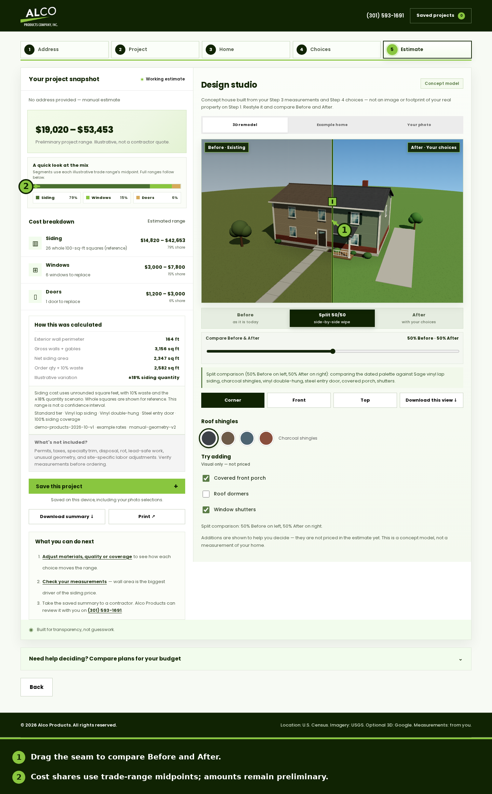

# 19 — CurbQuote v0.14 visual and interaction pass

This pass builds on the v0.13 five-step homeowner journey. It keeps the Alco forest-green and lime palette, self-hosted Poppins, 3D-first property story, and the existing estimate and disclosure rules. No eyebrow labels were added.

## What changed

### Before/After comparison on the canvas

The split seam can now be dragged directly across either 3D stage. A pointer within 18 CSS pixels of the seam gets an `ew-resize` cursor; dragging elsewhere still orbits the concept house, while two-finger gestures still zoom. Dragging updates the split range, readout, quick-choice pressed states, and `remodelDesign.split` in real time. The range is now precise to one percentage point.

When a comparison is active, two high-contrast corner badges identify **Before · Existing** and **After · Your choices** on the stage itself. They disappear at the full Before or full After endpoints. The canvas remains one shared, on-demand WebGL renderer; there is no idle render loop.

### Cost-share visuals and proportional framing

The Step 2 scope dock and Step 5 estimate now include an SVG cost-share bar. Siding, windows, and doors are split by the midpoint of each selected illustrative range, with the dollar ranges and percentages shown nearby. This is a visual explanation of the preliminary range—not a quote or a new pricing calculation. The SVG uses geometry attributes and CSS classes, with no inline styles.

Steps 2–4 retain a 1.618:1 primary-to-dock split; Step 5 uses the inverse 1:1.618 estimate-to-studio split. Sticky companion docks align with the primary card on desktop. Below 981 px the Step 3/4 dock becomes a compact 16:9 stage, and the Continue action remains ahead of it in the page order so it is not buried under a long preview.

### Architectural detail and interaction polish

The 3×3 reticle rests at low opacity and brightens on hover, focus, orbit, or split dragging. The concept house gains a soft ground contact-shadow apron, textured sky reflections in its window glass, joints in the front walk, and more dimensional foundation planting. Porch, dormer, shutter, roof, and siding choices trigger a small camera response; it is suppressed under reduced-motion preferences.

The step navigation now shows a proportional progress line and announces “Step n of 5” to assistive technology. Tier and color/roof selections have stronger selected and focus feedback. Buttons and quick 3D controls have a minimum 44 px target. Reduced-motion rules continue to disable motion effects.

## Visual audit

The running app was reviewed in Chromium at 320, 360, 390, 560, 768, 921, 1024, 1440, and 2560 px widths, plus 844×390 landscape. The browser QA checks all five homeowner steps at those sizes, including maximum legal input values; page width stays within the viewport and the added cost-share labels remain within their boxes. Visible buttons and form controls, plus the full labels for checkbox/radio controls, meet 44×44 CSS pixels in the same matrix. The 1024, 1440, and 2560 desktop layouts keep the proportional frame; at 768 px and below, the primary controls and 3D dock stack cleanly.

The before images were captured from the same branch immediately before the v0.14 changes, with the same example measurements and a 50/50 split. The after images use the local concept house with no optional Google credential or real property imagery. Screenshots contain no customer data or credentials.



- [Before, desktop (1440 px)](assets/ui-review/v014-before-desktop.png) · [After, desktop (1440 px)](assets/ui-review/v014-after-desktop.png) · [Annotated desktop](assets/ui-review/v014-annotated-desktop.png)
- [Before, mobile (390 px)](assets/ui-review/v014-before-mobile.png) · [After, mobile (390 px)](assets/ui-review/v014-after-mobile.png) · [Annotated mobile](assets/ui-review/v014-annotated-mobile.png)
- [Step 2 cost-share dock](assets/ui-review/v014-step2-cost-share-desktop.png) · [Compact Step 3 dock on mobile](assets/ui-review/v014-step3-compact-mobile.png)

The annotated screenshots mark the draggable seam and the midpoint-based cost-share summary. The step 3 mobile capture checks that the Next button is reached before the compact dock in the visual reading order.

## Verification

```text
npm run check          # syntax checks, 78 Node tests, public build
npm run build:pages    # static GitHub Pages build
npm run test:python    # Python exterior-data tests
npm run test:browser   # app, map, and remodel Chromium checks at 10 viewports
npm run test:exterior  # local Austin exterior model, controls, cancellation and fallback
```

The security headers in `lib/web.mjs` and `vercel.json` are unchanged. Browser requests remain relative, the optional Google 3D tiles remain display-only, and the editable studio remains a concept house based on homeowner-entered measurements. Porch, dormer, and shutter additions remain visual-only and are not priced.
