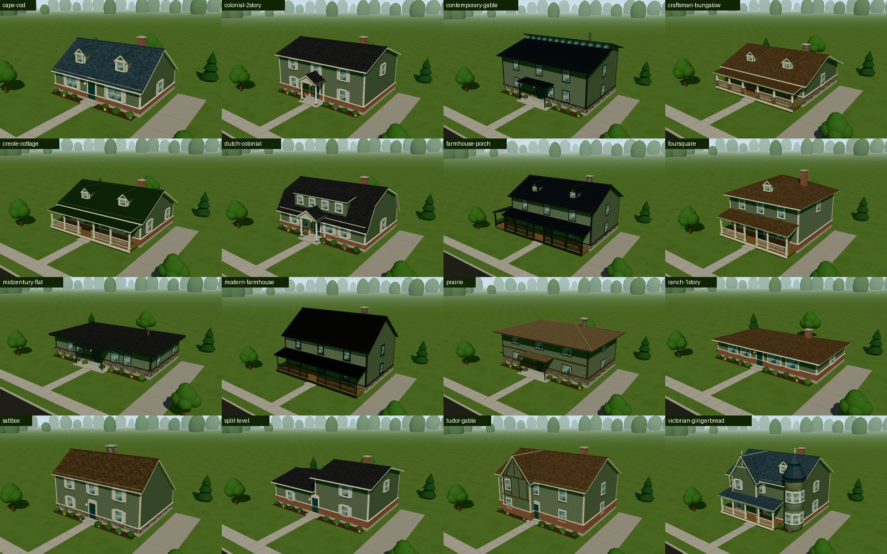
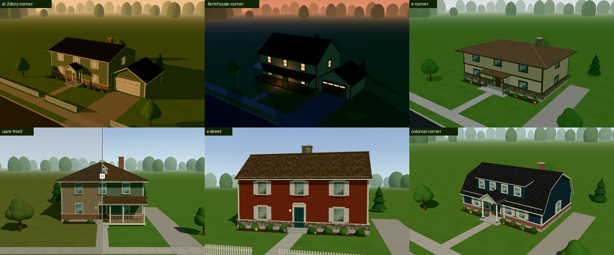
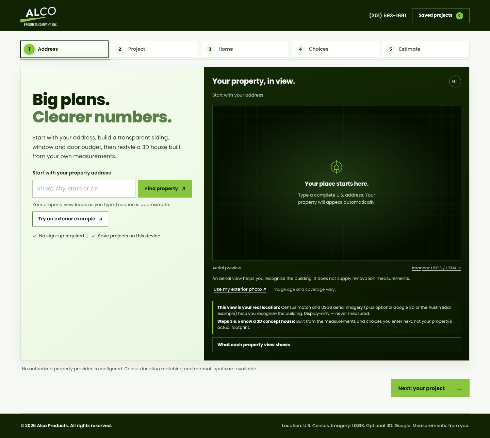
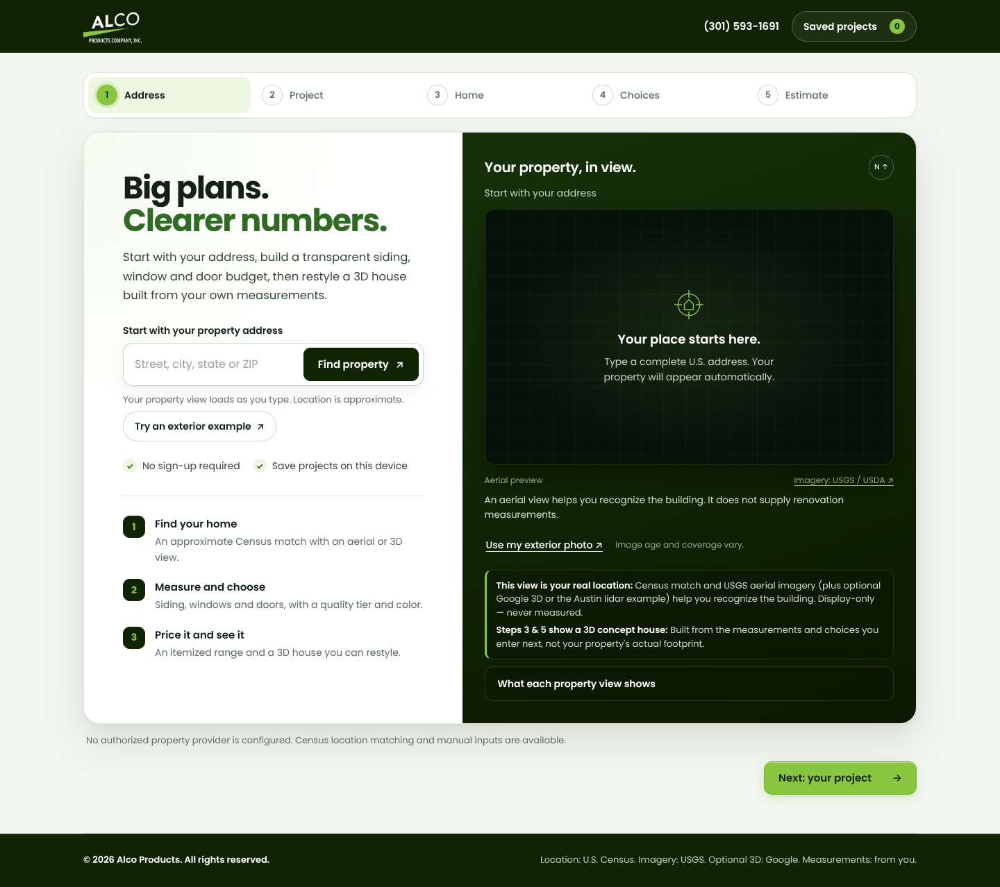
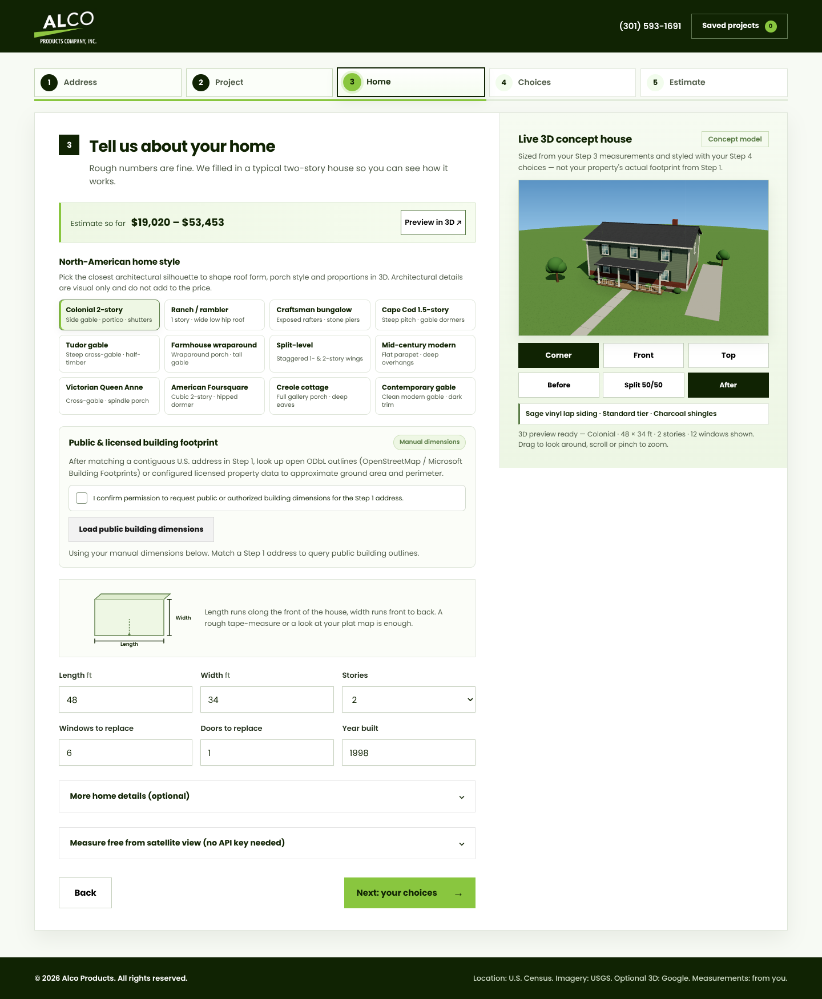
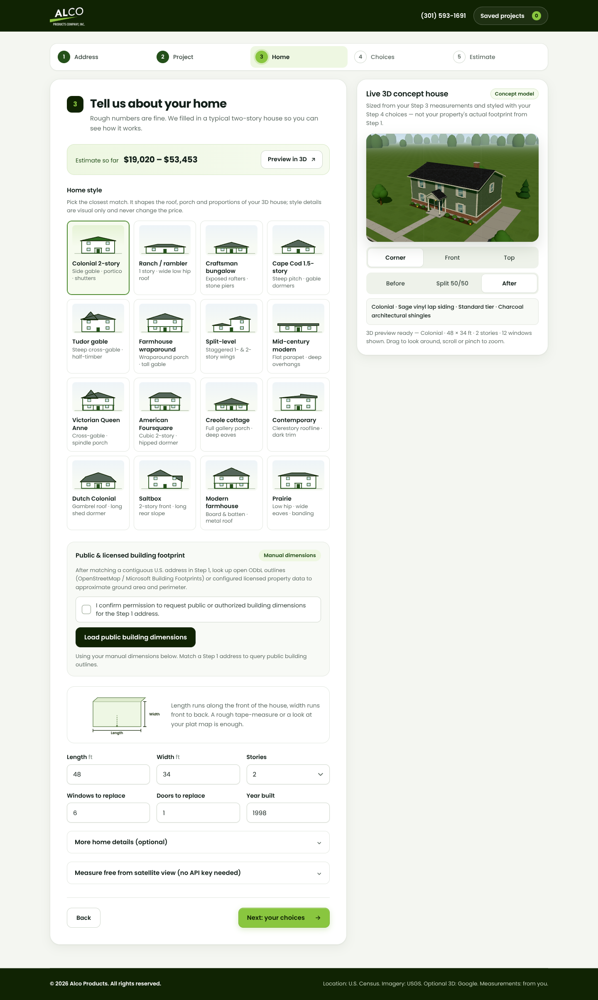
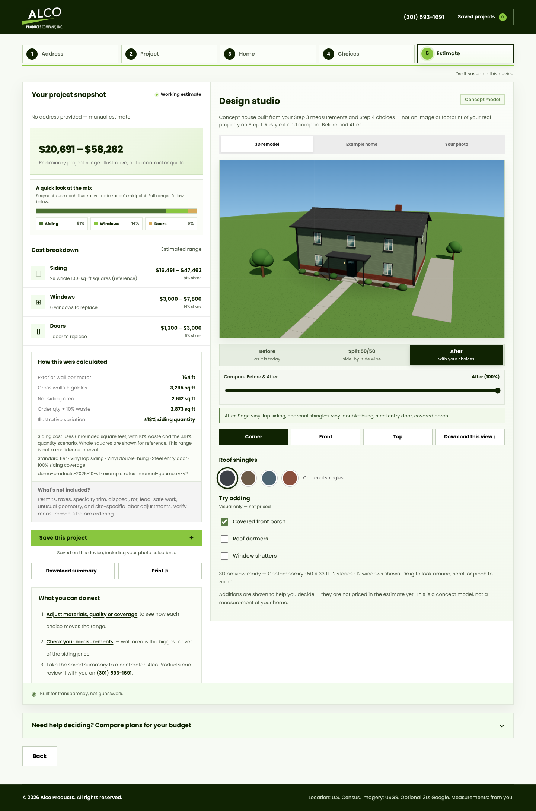
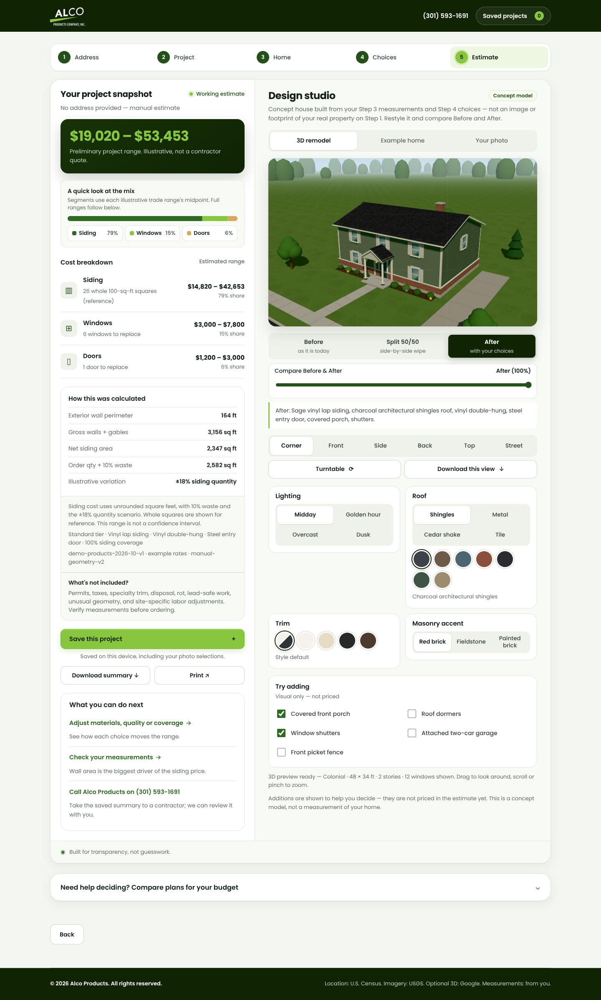
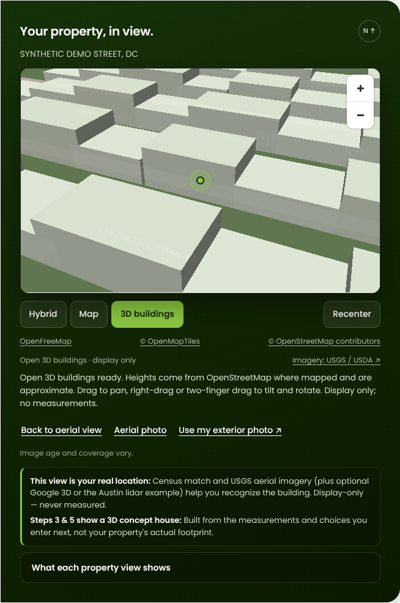

# 20 — CurbQuote v0.15: professional redesign, rebuilt 3D houses and property-view fallbacks

This pass replaces the layered stylesheet with one design system, rebuilds the 3D concept-house
geometry so every home style renders correctly, adds studio options and four home styles, and makes
the property view degrade through a chain of free fallbacks until the Google Map Tiles key is live.
Estimate maths, pricing, disclosures and the "concept model, not a measurement" guardrails are
unchanged. No eyebrow labels were added.

## Rebuilt 3D houses

The old studio built roofs from rotated boxes. Hip roofs (Ranch, Foursquare) came out as broken,
overlapping slabs, the lawn was a disc whose edge drew a fake curved horizon, and the driveway floated
in the grass. The renderer in `remodel-3d.js` now builds:

- **Real roof planes** extruded from each style's cross-section: gable, gambrel (Dutch Colonial),
  saltbox, and a clerestory "offset shed" (Contemporary), plus true four-plane hips and a flat roof
  with a deep fascia. Each plane has thickness, so eaves show fascia boards and soffits, with gutters
  and ridge caps.
- **Cross-gable wings** (Tudor, Victorian) as their own extruded volume, a Victorian turret with a
  conical roof, gable and long shed dormers seated on the actual slope, Craftsman knee braces,
  Prairie banding, and an exterior chimney that always clears the ridge.
- **A real lot**: street, curb, sidewalk, front walk, and a driveway that leads to the garage (or
  beside the house), foundation beds, trees, and a distant tree line on a ground plane that fades into
  a sky dome instead of ending at a visible edge.
- **Lighting**: image-based lighting from the sky, soft PCF shadows fitted to the house, and neutral
  tone mapping so a homeowner's chosen siding color is not hue-shifted. The deprecated
  `PCFSoftShadowMap` warning is gone.
- **Framing** from the building's bounding sphere and the stage's aspect ratio, so every style and
  addition fits both the Step 3/4 dock and the Step 5 studio.



[The same view before this pass](assets/ui-review/v015-styles-before.jpg).

## More options

| Area | Added |
|---|---|
| Home styles | Dutch Colonial (gambrel, shed dormer), Saltbox, Modern farmhouse (board and batten, metal roof, black trim), Prairie (low hip, 3 ft eaves, banding). 16 in total; each card shows a drawing generated from the style's proportions (`styleSilhouette`). |
| Siding colors | Deep navy, Forest, Warm greige, Barn red, Butter yellow, Iron black (12 in total), shown as labelled chips. The assistant's schema follows the catalog instead of a hard-coded list. |
| Roof | Covering: architectural shingles, standing-seam metal, cedar shake, barrel tile. Colors: Onyx black, Forest green and Desert sand added (7 in total). |
| Trim and masonry | Trim: style default, classic white, cream, black or bronze. Masonry accent: red brick, fieldstone or painted brick. |
| Additions | Attached two-car garage and front picket fence, alongside porch, dormers and shutters. All additions remain visual-only and never appear in Before. |
| Camera and light | Corner, Front, Side, Back, Top and Street (eye-level) views, a turntable orbit, and Midday, Golden hour, Overcast and Dusk lighting (dusk lights the windows and lanterns). |



Styles carry their own roof covering and masonry defaults (for example, Modern farmhouse starts with
a black metal roof); trim, lighting, garage and fence stay as the homeowner set them. None of these
options touch `estimate.js` or the price.

## Professional redesign

`styles.css` was several theme layers overriding each other (about 78 KB). It is now one design
system (about 61 KB): a single token set for color, radius, elevation and focus; one type scale; card
layout for every step; a connected progress stepper; a search-bar style address field; a sticky live
3D dock beside Steps 2–4; segmented controls for views, Before/After and finishes; and a grouped
Step 5 studio. Step 1 adds a three-step "how it works" summary on wide screens.

| Before | After |
|---|---|
|  |  |
|  |  |
|  |  |

Also: [Step 4 after](assets/ui-review/v015-after-step4-desktop.png) and
[Step 1 on a phone](assets/ui-review/v015-after-step1-mobile.png).

The browser QA still holds every target to 44 × 44 CSS pixels and checks for page overflow and
clipped labels on all five steps at ten viewports from 320 px to 2560 px, including maximum input
values. Two narrow-screen issues found by that matrix were fixed during this pass.

## Property-view fallback chain

Until the Google Map Tiles key is configured, and whenever Google fails at runtime, the property view
degrades in tiers so something useful always shows:

1. **Reviewed local exterior**: the Austin lidar example, for that one property.
2. **Google Photorealistic 3D Tiles** with `GOOGLE_MAP_TILES_KEY` (launch) or `CESIUM_ION_TOKEN`
   (testing). A denied root request falls back immediately. A key that runs out of quota or is
   revoked mid-visit is caught by tile-failure tracking (`property-3d.js`) and falls back too.
3. **Open 3D buildings (new, no key)**: MapLibre extrudes OpenStreetMap building heights
   (`render_height`, else a one-story guess) over the USGS aerial imagery with a tilted camera.
   **View in 3D** opens it when Google is not configured, and the Google path hands over to it on
   failure. It is also a **3D buildings** mode beside Hybrid and Map.
4. **USGS / USDA aerial photo**: still the automatic default after an address match when Google is not
   configured, because it needs no WebGL.
5. **Street map**: OpenFreeMap vector tiles, used automatically if aerial tiles fail.
6. **The homeowner's own photo**, always available.



The screenshot uses a synthetic block of buildings (this sandbox cannot reach OpenFreeMap). Real
OpenStreetMap heights vary by area; unmapped buildings show as one story.

## Backend and configuration

- `vercel.json` gives each function a budget that matches its internal deadlines: geocode 10 s,
  map3d 5 s, property 10 s, footprint 25 s and assistant 30 s (its agent stops at 25 s).
- Static caching: fonts are immutable for a year; vendor runtimes (Three.js, CesiumJS, MapLibre),
  brand images and the exterior model are cached for a week with background revalidation. App modules
  stay `no-cache` so deploys apply immediately. `CACHE_RULES` in `lib/web.mjs` mirrors these rules, and
  a test keeps them identical to `vercel.json`.
- Security headers add `Permissions-Policy` (no camera, microphone, location, payment or USB) and
  `Cross-Origin-Opener-Policy: same-origin`, still byte-identical between `lib/web.mjs` and
  `vercel.json`. The CSP is unchanged.
- `/api/geocode` now has the same per-instance request guard as the other lookups (90 requests per
  10 minutes per caller), and every guard keys on a SHA-256 hash of the caller from `clientKey()`,
  which also honours `x-forwarded-for`.
- The development / self-hosted server sends Brotli or gzip for text and WASM assets (cached per file
  version), ETags with `304 Not Modified`, and the same cache rules as production.

## Google Map Tiles API readiness

Nothing else is needed in code: set `GOOGLE_MAP_TILES_KEY` (see [SETUP §3](SETUP.md#3-3d-view-pick-one-credential))
and redeploy. The 3D view then leads after an address match, the key is restricted to the site
origin by the `strict-origin` referrer policy, and every failure mode lands on the next tier above.

## Verification

```text
npm run check          # syntax checks, 95 Node tests, public build
npm run test:browser   # 56 Chromium checks: app (39), map (11), 3D remodel (6)
npm run test:exterior  # 6 checks for the Austin exterior model
```
