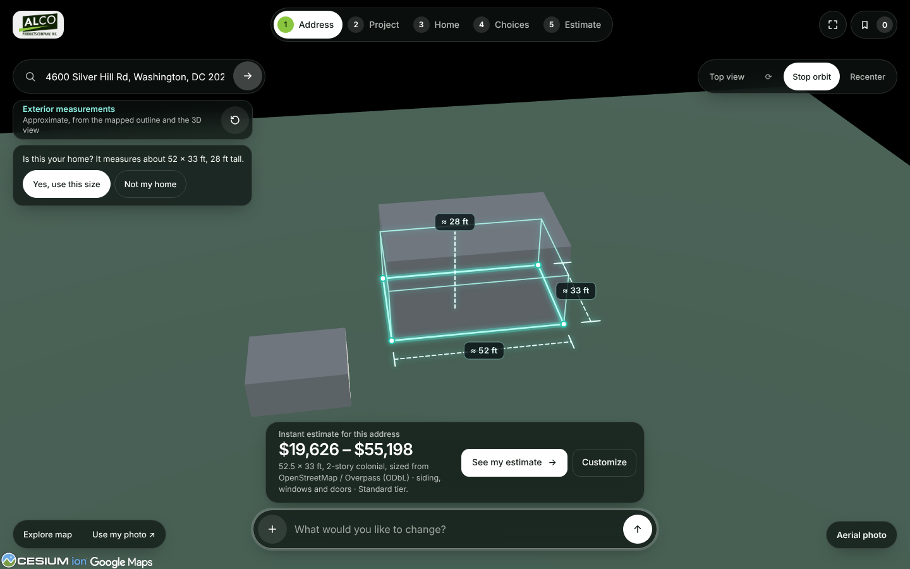
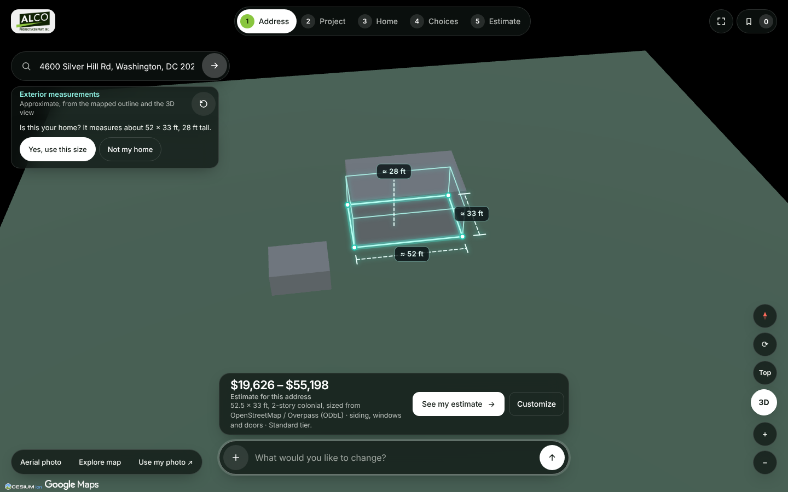
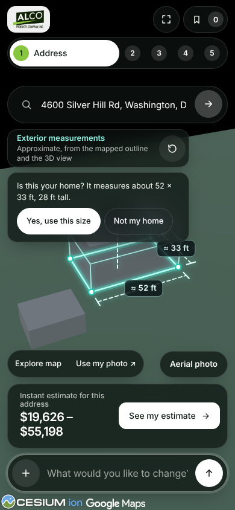
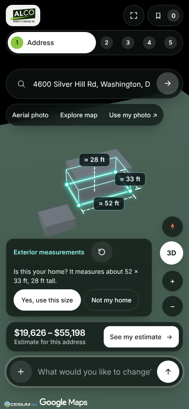

# 21 — CurbQuote v0.16: Step 1 toward the owner's mock-ups

The owner's four concept images show Step 1 as a full-bleed photo-real 3D view circling the house, a
measuring overlay, and a few small glass panels. This pass moves the live Step 1 toward them. The
estimate maths, the consent flow and the "Is this your home?" rule are unchanged: a measured size only
reaches the estimate after the homeowner confirms it. No eyebrow labels were added (the mock-ups'
uppercase card captions are sentence case here).

## What changed

- **Camera.** The Google 3D view looks down at 42° (was 35°) from farther out (70–220 m, scaled to
  the building), so the street and the neighbours frame the house. The camera aims a little in front
  of the house so it sits in the open area between the floating panels instead of behind the price card
  and the chat bar; the offset follows the camera as it circles.
- **One 3D button.** The 3D tools moved from a text toolbar at the top right to round buttons at the
  bottom right, as on a map: compass (face north), quarter turn, top view, **3D** (circle the home) and
  new zoom in / zoom out. On phones the toolbar used to be hidden; now compass, 3D and zoom show.
  "Aerial photo / View in 3D" joined Explore map and Use my photo at the bottom left.
- **One measuring card.** "Exterior measurements" and "Is this your home?" read as one panel.
- **Labels stay readable.** A dimension label that would land under a panel moves just clear of it
  (`clearOf` in `measure-overlay.js`, unit-tested), as in the third mock-up.
- **Loading.** "Loading the 3D view…" shows until the tiles around the building have arrived, instead
  of an empty green frame.
- **The price card says what it is.** It reads "Estimate for a typical home" until the size comes from
  the home itself, then "Estimate for this address", and it is a slimmer bar above the chat bar.
- **Phones.** The view options sit under the search box, the measuring card sits low beside the 3D
  stack, the price fits on one line, and Google's credits get their own strip under the chat bar.

| | Before | After |
|---|---|---|
| Desktop |  |  |
| Phone |  |  |

The screenshots use the synthetic tileset from `qa/fixtures/tiles3d.mjs`; the same layout was checked
against real Google 3D tiles on the live Pages configuration, without committing real-address imagery.

## Verification

```text
npm run check          # syntax checks, 112 Node tests, public build
npm run test:browser   # 62 Chromium checks
npm run test:exterior  # 9 checks
```
