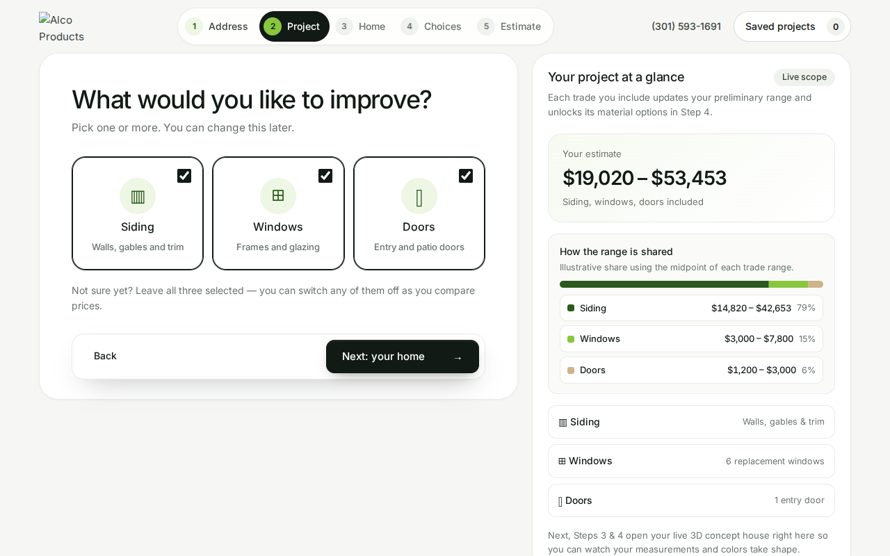
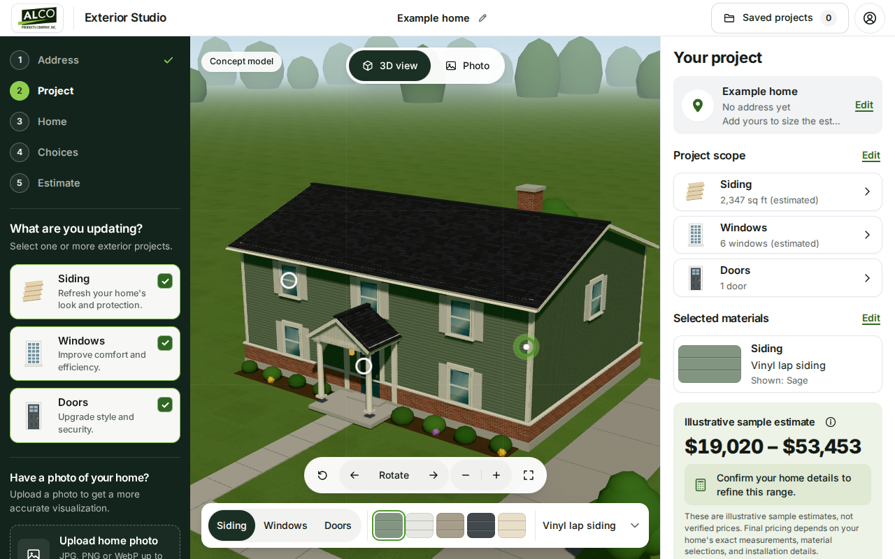
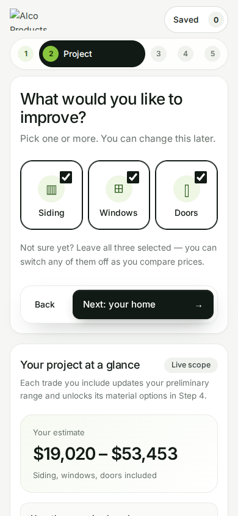
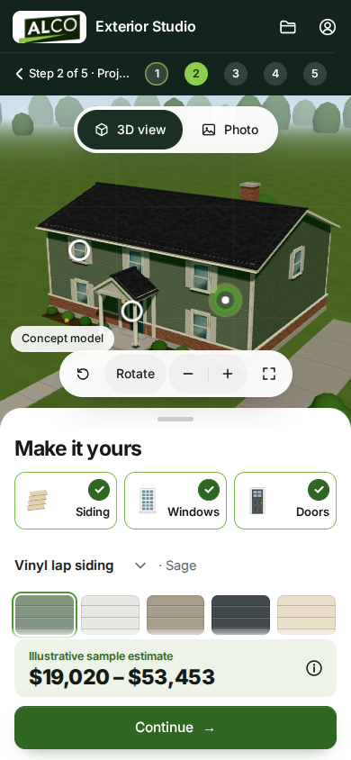
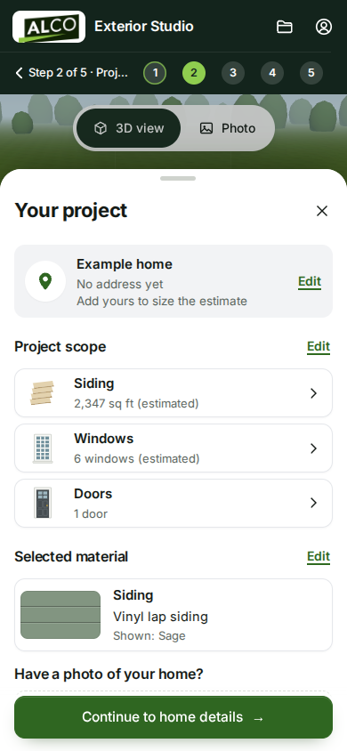

# 22 — CurbQuote v0.17: the Exterior Studio

The owner's mock-ups ("Studio" on desktop, "Mobile · Studio" and "Mobile · Project details") turn
Steps 2–4 into one studio: the steps and the step's own controls in a forest-green rail, the house in
the middle, and "Your project" on the right. This pass builds that shell around the app's real data.
The estimate maths, the consent flows and the "Is this your home?" rule are unchanged. No eyebrow
labels were added: the phone mock-up's uppercase "ILLUSTRATIVE SAMPLE" reads "Illustrative sample
estimate" here.

| | Before | After |
|---|---|---|
| Desktop, Step 2 |  |  |
| Phone, Step 2 |  |  |
| Phone, project sheet | — |  |

The 3D house is the existing concept model (`remodel-3d.js`), not a photo of a property. The "before"
images show a broken logo: that was the WebP bug fixed below.

## What changed

- **Top bar (every step).** Logo tile, "Exterior Studio", the project name with a pencil that renames
  it, Saved projects with its count, and an account button. Renaming uses the same name as the save
  dialog; a project that is already saved is renamed on this device straight away. There are no
  accounts, so the account button says so and offers Saved projects and a call to Alco Products (the
  phone number moved there from the old header).
- **The rail (Steps 2–5).** The five steps as a vertical list: earlier steps get a lime tick, the
  current one a lime circle. They are the same `data-goto` buttons with `aria-current` and the live
  "Step n of 5" readout. Below the steps sits each step's own content: Step 2's project cards and photo
  upload, Step 3's home details, Step 4's choices. The cards are the same `#scope-*` checkboxes.
- **The house (Steps 2–4).** The 3D concept house fills the middle, coloured by the current choices.
  - **3D view / Photo.** Photo shows the homeowner's photo with any walls they marked, else the aerial
    photo of the matched address, else an upload prompt.
  - **Hotspots.** Rings sit on a clear patch of siding, a window and the entry door. Rays cast from the
    camera choose them, so they sit on what is really visible (a porch column never hides the door's
    ring), follow the camera every frame and hide when their surface turns away. Picking one selects
    that surface in the material bar.
  - **Control pill.** Reset, rotate left and right, a slow turn, zoom and full screen.
  - **Before / Split / After.** Steps 3 and 4 keep the comparison; Step 3 has no material bar.
- **The material bar (Steps 2 and 4).** Siding / Windows / Doors tabs, five swatches, and the
  material for that surface. Every change goes through the Step 4 control, so the estimate, drafts and
  saved projects see it as before.
  - **Siding** offers five of the twelve colours in `project.js`; a colour picked in Step 4 takes the
    fifth place.
  - **Windows** offers the five trim colours.
  - **Doors** offers the three door finishes.
- **"Your project" (Steps 2–4).**
  - **Address card.** The address, with Edit going back to Step 1.
  - **Scope rows.** Worked out live: the net siding area, the windows and doors to replace, or "Not
    selected". Each row opens the field its number comes from.
  - **Material card.** The selected surface's material.
  - **Estimate card.** The live range, its ⓘ breakdown, the callout and the disclaimer. The breakdown is
    the cost-share bar that used to sit beside Step 2.
  - **Continue.** The button reads Continue to home details, Continue to choices, then See my estimate.
- **Phones and narrow windows** (under 1024 px wide or 600 px tall).
  - **Header.** Dark, two rows: logo, "Exterior Studio", folder and account on the first; back,
    "Step 2 of 5 · Project" and the step dots on the second.
  - **Studio sheet.** The house sits on top and the studio is a bottom sheet with a sticky Continue.
  - **Project sheet.** "Your project" opens as a second sheet from the estimate strip, the folder
    button or a swipe up on the handle. The ×, Escape, a tap outside or a swipe down close it. While it
    is open, the page behind it is inert and focus moves into the sheet.
- **Step 1** keeps its full-bleed 3D hero under the new top bar; its steps sit in the middle of the bar.
  **Step 5** keeps its two columns beside the rail.
- **Colours** are CSS variables: forest `#13241c` for the rail and phone header, green `#2f6621` for
  primary buttons, lime `#8fcd4f` for the current step, pale green `#edf3e7` for estimate surfaces. The
  values were sampled from the mock-ups.

## Where the app follows its real data instead of the mock-ups

- **Colour names** come from `project.js` ("Sage", not "Sage green").
- **The upload limits** read "JPG, PNG or WebP up to 12 MB", which is what the photo editor accepts.
- **The Windows row** counts the windows to replace, which is what is priced. The mock-up's 12 is the
  house's total.
- **The range** always covers the trades that are selected. The mock-up shows Doors "Not selected"
  beside a three-trade price.
- **Doors** have no colour of their own in the price book, so the Doors swatches are the three door
  finishes, and picking one picks that door.
- **"Concept model"** stays on the 3D view, as everywhere else the concept house appears.
- **Pills, tabs and swatches** are a little taller than drawn, to keep every control at least 44 × 44 px.

## Accessibility

- **3D view / Photo** is a pressed-button group.
- **The surfaces** are a `tablist` with arrow keys.
- **The swatches** are a radio group with arrow keys and one tab stop.
- **Hotspots** are real buttons (Tab, Enter) with a pressed state and a description.
- **Checkboxes** stay real inputs, styled with `appearance: none`.
- **Photo uploads.** Every "Upload home photo" control is a button that opens one hidden file input. The
  input moved out of Step 5 so it opens from any step, and Step 5's label became a button, which
  keyboards can now reach.
- **Reduced motion:** the sheets appear without sliding, camera moves jump, and Rotate turns a quarter
  instead of spinning.

## Fixed along the way

- **The development server answered the WebP logo with HTTP 500.** It had no `image/webp` type, so the
  header logo was broken locally, and `qa/map-browser.mjs` and `qa/remodel-browser.mjs` failed their
  "no console errors" checks on `main`. It now serves `image/webp`, and `tests/web.test.js` checks it.

## Verification

```text
npm run check          # syntax checks, 119 Node tests, public build: pass
npm run test:browser   # 65 Chromium checks (45 + 13 map + 7 remodel): pass
npm run test:exterior  # stops at qa/exterior-browser.mjs:160, on main too (see below)
```

- **The browser suite.** It has one new check: the material bar, tabs, hotspots and swatch radio
  group edit the same Step 4 choices and estimate, and the phone project sheet opens with focus and
  closes on Escape. The Step 2 cost-share check now opens the ⓘ breakdown and asserts it is visible
  and adds to 100%. The overflow and 44 × 44 target sweeps cover the new shell at all 10 viewports and
  five steps.
- **The exterior suite.** It times out at line 160, the Step 1 Google 3D "tap the garage" measuring
  pass, with the same timeout on `main` plus the WebP fix. The machine used here renders WebGL in
  software, and this work does not touch that view.

## Known gaps

- **At 1280 × 800** the right panel needs a short scroll to reach Continue; the mock-up fits it
  exactly. The disclaimer wraps to four lines in the slightly narrower panel.
- **At 390 px** the phone header shortens "Step 2 of 5 · Project" to "Step 2 of 5 · Proj…" (it has
  to fit beside five 44 px step buttons); under 390 px it shows only the step name.
